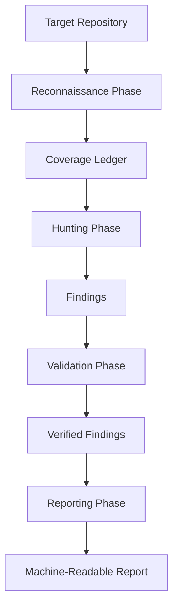

# Cobalt Lab | AI & Machine Learning

> Work in progress. This checkpoint may be incomplete or fail tests. See PLAN.md and STATUS.md before use.


**Author**: Ryan Vo (ryandtvo@gmail.com)

A coding-agent skill for multi-phase security audits with independently verified, machine-readable findings.

## Overview

Cobalt Lab provides a structured, multi-phase security audit framework that runs as a coding-agent skill. It decomposes audit work into distinct phases (reconnaissance, hunting, validation, reporting) with independent verification at each step. Findings are emitted as machine-readable JSON, enabling programmatic consumption and CI/CD integration.

## Architecture



## Features

- **Multi-phase audit pipeline**: Reconnaissance → Hunting → Validation → Reporting
- **Independent verification**: Each finding validated by a separate verifier agent
- **Machine-readable output**: JSON findings and coverage ledger for tooling
- **Configurable profiles**: Quick, Standard, and Deep audit profiles
- **LLM provider agnostic**: Supports OpenAI-compatible, Anthropic, Gemini, Ollama
- **OIDC authentication**: Keycloak with SAML broker support
- **Deterministic offline core**: Core algorithms work without LLM keys

## Quick Start

### Prerequisites

- Python 3.12+
- Node.js 24+
- Docker (for Keycloak and containerized deployment)

### Local Development

1. **Clone and setup backend**:
   ```bash
   python3 -m venv .venv
   source .venv/bin/activate
   pip install -r backend/requirements.txt
   ```

2. **Setup frontend**:
   ```bash
   cd frontend
   npm install
   ```

3. **Configure environment**:
   ```bash
   cp .env.example .env
   # Edit .env with your settings
   ```

4. **Start Keycloak** (for auth):
   ```bash
   docker compose up -d keycloak
   # Wait for Keycloak to be ready at http://localhost:8080
   ```

5. **Run backend**:
   ```bash
   .venv/bin/uvicorn app.main:app --host 0.0.0.0 --port 8000
   ```

6. **Run frontend** (in another terminal):
   ```bash
   cd frontend
   npm run dev
   ```

7. **Open** http://localhost:5173

### Docker Compose (Full Stack)

```bash
docker compose up --build
```

- Frontend: http://localhost:5173
- Backend API: http://localhost:8000
- Keycloak Admin: http://localhost:8080 (admin/admin)

### Testing

**Backend tests**:
```bash
.venv/bin/pytest backend/tests -v
```

**Frontend tests**:
```bash
cd frontend
npm test
```

**All tests with Docker**:
```bash
docker compose run --rm backend pytest backend/tests -v
docker compose run --rm frontend npm test
```

## API Reference

### Health Check
```
GET /api/v1/health
```
Returns service status.

### Items (Demo CRUD)
```
POST   /api/v1/items          Create item
GET    /api/v1/items          List items (pagination: skip, limit)
GET    /api/v1/items/{id}     Get item
PATCH  /api/v1/items/{id}     Update item
DELETE /api/v1/items/{id}     Delete item
```

## Configuration

| Variable | Description | Default |
|----------|-------------|---------|
| `SECRET_KEY` | JWT signing secret | Required in production |
| `DATABASE_URL` | SQLAlchemy database URL | `sqlite+aiosqlite:///./cobalt_lab.db` |
| `CORS_ORIGINS` | Allowed CORS origins | `["http://localhost:5173"]` |
| `OIDC_ISSUER_URL` | Keycloak realm URL | `http://localhost:8080/realms/cobalt-lab` |
| `OIDC_CLIENT_ID` | OIDC client ID | `cobalt-lab` |
| `OIDC_CLIENT_SECRET` | OIDC client secret | Required in production |
| `OIDC_REDIRECT_URI` | OAuth redirect URI | `http://localhost:5173/callback` |
| `LLM_PROVIDER` | LLM provider type | `openai-compatible` |
| `LLM_MODEL` | Model name | - |
| `LLM_BASE_URL` | Provider base URL | - |
| `LLM_API_KEY` | Provider API key | - |

## Security

- **Authentication**: OIDC authorization code flow with PKCE
- **Session management**: HttpOnly SameSite cookies with CSRF protection
- **Authorization**: Role-based access control (viewer, operator, admin)
- **Token validation**: Signature, issuer, audience verified
- **No hardcoded secrets**: All credentials via environment variables
- **Demo mode**: Explicitly enabled, refuses to start in production

## Deployment

### TLS Reverse Proxy (Required for Production)

```nginx
server {
    listen 443 ssl;
    server_name your-domain.com;

    ssl_certificate /path/to/cert.pem;
    ssl_certificate_key /path/to/key.pem;

    location / {
        proxy_pass http://localhost:5173;
        proxy_set_header Host $host;
        proxy_set_header X-Real-IP $remote_addr;
    }

    location /api/ {
        proxy_pass http://localhost:8000;
        proxy_set_header Host $host;
        proxy_set_header X-Real-IP $remote_addr;
    }
}
```

### Backup/Restore

```bash
# Backup SQLite database
cp cobalt_lab.db cobalt_lab.db.backup

# Restore
cp cobalt_lab.db.backup cobalt_lab.db
```

## License

MIT License - Copyright (c) 2024 Ryan Vo <ryandtvo@gmail.com>
